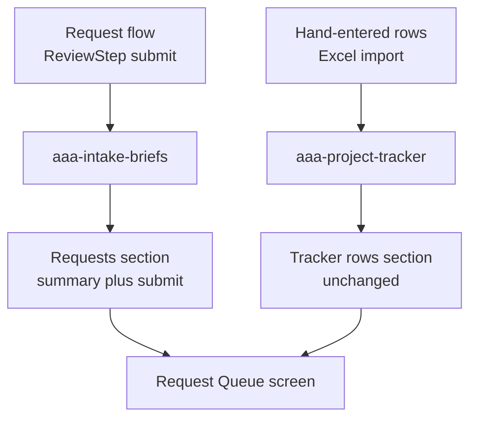

# Request Queue

Split into two phases. Phase 1 is the rename only, which is what was asked for on 2026-09-16 at
16:32. Phase 2 is the queue feature, approved earlier the same afternoon and deferred until the
rename lands.

## Phase 1 - rename the section to Request Queue

Seven user-facing strings.

1. `src/App.tsx` - the route table entry, which feeds both the header title beside the logo and the
   browser tab:

   ```
   { path: "/deliverables", title: "Deliverables", documentTitle: "Deliverables" },
   ```

   Both become "Request Queue".

2. `src/views/DeliverablesView.tsx` - the `h1`, currently "Deliverables".

3. `src/views/DeliverablesView.tsx` - the two load-status messages, "Recovered your deliverables from
   the local backup copy." and "Saved deliverables could not be read from this browser...".

4. `src/views/DeliverablesView.tsx` - "Clear all tracker rows from this device", so the control names
   the same thing the heading does.

5. `src/views/HomeView.tsx` - the footer link "Deliverables tracker", and the clear-data confirmation
   that says "Deliverables tracker rows are not affected".

6. `src/views/request/ConfirmedStep.tsx` - "View the deliverables tracker".

7. `src/lib/related/coverage.ts` - "Rows in the deliverables tracker". This one is easy to miss: it
   appears inside the duplicate-check coverage disclosure, which must accurately name the corpus it
   searched, so leaving it stale would make that disclosure wrong.

### Deliberately NOT renamed

- **`Project/Deliverables`** - the tracker's column header. It is `EXPORT_HEADERS[0]` in
  `src/lib/types.ts`, so it is the literal heading in every exported spreadsheet, and
  `HEADER_ALIASES` in `src/lib/excel.ts` maps it back on import. Renaming it breaks round-tripping
  with spreadsheets users already hold. It is also the `aria-label` queried in
  `DeliverablesView.tsx` to focus a newly added row, so a rename there silently breaks that focus
  unless the selector changes with it. Appears in `TrackerTable.tsx`, `RowFields.tsx`,
  `src/lib/types.ts`.
- **`A3IntakeDeliverables`** and its label "Deliverables", plus the A3 section "Deliverables and
  outcomes". Workfront contract; the app never renames a Workfront field or label.
- **`aaa-project-tracker`** and `aaa-intake-briefs` storage keys. Real user data, no server copy,
  never renamed without a migration.

### Not in phase 1

The route stays `/deliverables` and the file stays `DeliverablesView.tsx`. Only the reading changes,
which is what was asked. Renaming the route to `/queue` with a redirect from the old path is a clean
follow-up but touches both probe scripts, `docs/deployment.md`, `README.md`, and the comment in
`public/_redirects`.

### Verification

Typecheck, build, re-run `scripts/verify-flow.mjs` and `scripts/probe-csp.mjs` (neither depends on
the changed strings, but both walk the screen), rebuild the preview on 4173, and screenshot the
header and the screen.

Docs: `README.md` route table, `docs/INDEX.md`, and a dated decision-log entry noting that the
tracker was renamed on screen while its storage key and export headers deliberately did not change.

## Phase 2 - the queue feature, deferred

Approved decisions, unchanged:

- **Requests are the queue; hand-entered rows stay.** Tracker rows keep their own labeled section
  with the table, Excel import and export, reordering, and clear-all untouched.
- **Submit stays where it is, and the queue adds one.** The Review step still submits; the queue can
  submit a request still sitting as a draft. No re-submitting.

### Why it is needed

A saved request is currently write-only. `loadBriefs` exists and every brief persists to
`aaa-intake-briefs`, but no screen lists them, so a requester can finish the flow and never see the
request again.

### Data sources



The two models share no fields, which is why they are two sections rather than one table.

### Shape

New section above the tracker rows reading `loadBriefs()` newest first. Per request: title from
`briefTitle`, ALAN number, team routing, deadline, created date, status. Expanding shows the
assembled brief read-only via `groupA3BySection` so it reads in Workfront field order. A draft gets a
Submit action wired to the existing `submitToWorkfront`, which already validates the six required A3
fields and names what is missing; success patches status and the stub result through `upsertBrief`.

Two non-negotiables:

- **Requester name and department only, never email.** Guardrail 6 forbids a requester's email in a
  request listing.
- **"Submitted" must not read as "sent to Workfront."** `submitToWorkfront` makes no network call.

### Open question before phase 2 is built

On a screen called a queue, a "Submitted" badge invites the reading that something is queued for
Workfront. Nothing has been sent. Options are to keep "Submitted" with a clarifying footnote, or to
use an unambiguous label such as "Ready to send" until real submission exists. Worth deciding before
building rather than after.

### Out of scope

Deleting an individual request, exporting requests to Excel, and any live Workfront call.
