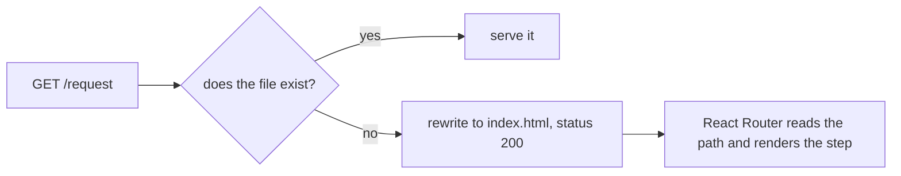

# Deploying Mission Control

Mission Control is a static single-page app. There is no server, no database, and no API call at
runtime. Everything a user enters lives in their own browser's `localStorage`.

That last sentence is a deployment fact, not a footnote. Read [What hosting does not
solve](#what-hosting-does-not-solve) before promising anyone that putting this on a server makes the
data shared.

---

## Build

```bash
nvm use                # reads .nvmrc
npm ci
npm run build          # tsc --noEmit, then vite build
```

Output lands in `dist/`. Serve that directory. `npm run build` fails on a type error before it
produces anything, so a bad build cannot be deployed by accident.

Verified on Node 24.15.0 and 25.9.0. `engines` declares `>=22.12.0`, which matches Vite 6's own
supported range for current release lines; versions between that floor and 24 are permitted but have
not been exercised here.

### Where the app lives: `APP_BASE_PATH`

One variable declares the path the app is served from. `vite.config.ts` normalizes it and hands the
same value to React Router via `import.meta.env.BASE_URL`, so assets and routes cannot end up
disagreeing.

| Serving from | Build command |
| --- | --- |
| `https://host/` | `npm run build` |
| `https://host/creative/` | `APP_BASE_PATH=/creative/ npm run build` |

Leading and trailing slashes are added if you omit them, so `/creative`, `creative/`, and
`/creative/` all work.

`APP_BASE_PATH` is deliberately **not** `VITE_`-prefixed. Anything with that prefix is compiled into
the public client bundle. Never put a secret in one.

**Set it for `vite preview` too, or the local check lies to you.** Preview reads `base` from the same
config, so without the variable it serves the build at the root while `index.html` asks for
`/creative/assets/...`. Preview's own SPA fallback then answers those asset requests with
`index.html` and a 200, so `curl` looks healthy while the real browser shows a blank page and
`Refused to apply style ... MIME type ('text/html')`. Verify a subpath build like this:

```bash
APP_BASE_PATH=/creative/ npm run build
APP_BASE_PATH=/creative/ npx vite preview --port 4173
node scripts/verify-flow.mjs http://localhost:4173/creative
```

---

## History fallback: the one thing every host must do

`/request`, `/deliverables`, and `/settings/questions` are client-side routes, not files. A direct
link or a mid-flow refresh asks the server for something that does not exist.



It must be an internal **rewrite**, not a redirect. A 301 or 302 changes the address bar and the
router loses the route the user asked for.

Configs ship for five hosts and are maintained as a set, per
`.cursor/rules/intake-project.mdc`. Change one, change all of them.

| Host | File | Notes |
| --- | --- | --- |
| Netlify | `public/_redirects`, `public/_headers` | Works as-is. |
| Vercel | `vercel.json` | Repo root, not `public/`. |
| Azure Static Web Apps | `public/staticwebapp.config.json` | Ships in the build output, which is where Azure looks. |
| IIS | `public/web.config` | **Requires the URL Rewrite module.** Without it IIS returns 500.19 at startup, which is at least a loud failure. |
| Apache | `public/.htaccess` | **Requires `mod_rewrite` and `AllowOverride FileInfo`.** With `AllowOverride None`, Apache ignores the file silently and deep links 404 with nothing in any log. Test `/request` directly after deploying rather than assuming. |

Two of these need a manual edit for a subpath deployment:

- Apache: set `RewriteBase` to the subpath.
- IIS: place `web.config` at the root of that application or virtual directory, not the site root.

Each config is inert on hosts that do not read it, which is why all five can ship together. The
tradeoff is that the unused ones remain publicly fetchable. They contain nothing confidential, but
they do advertise what this app was built to run on, so IIS and Apache are configured to refuse the
others.

---

## Security headers

Sent as real headers by every host config above, and by `vite preview` so the policy is exercised
locally. Deliberately **not** a `<meta>` tag: `frame-ancestors` and `X-Content-Type-Options` do not
work in meta at all, and a meta policy would also break the dev server's HMR.

For an ops team applying these by hand, the policy verbatim:

```
Content-Security-Policy: default-src 'self'; script-src 'self'; style-src 'self'; font-src 'self'; img-src 'self' data:; connect-src 'self'; object-src 'none'; base-uri 'self'; form-action 'self'; frame-ancestors 'none'
Referrer-Policy: no-referrer
X-Content-Type-Options: nosniff
Permissions-Policy: camera=(), microphone=(), geolocation=()
Cross-Origin-Opener-Policy: same-origin
```

Two things about this policy are worth knowing before someone "fixes" it:

**There is no `unsafe-inline` for styles, and it is not an oversight.** `RowActionsMenu` positions
itself with a React `style` prop, which looks like it should be blocked. React applies inline styles
through CSSOM rather than by writing a `style` attribute, and CSP does not intercept CSSOM. This was
confirmed against the built app.

**Fonts are never inlined, and that is load-bearing.** Vite base64-inlines assets under 4 kB and
several Open Sans subsets qualify. Under `font-src 'self'` the browser refuses every inlined font and
falls back to a system font for those glyph ranges, with no visible error. `vite.config.ts` therefore
excludes fonts from inlining. Do not "simplify" that by adding `data:` to `font-src`.

Add `upgrade-insecure-requests` if the host terminates TLS. It is omitted by default because an
internal HTTP-only deployment would break.

Verify after any change:

```bash
npm run build
npx vite preview --port 4173 &
node scripts/probe-csp.mjs http://localhost:4173
```

That script walks the flow, the admin view, and the tracker, and exits non-zero on any violation. It
is how the font-inlining break was found.

### Caching

Everything Vite emits into `assets/` is content-hashed, so it can be cached permanently.
`index.html` must not be: a returning user would otherwise keep loading the previous bundle and its
now-deleted asset URLs after a deploy.

| Path | `Cache-Control` |
| --- | --- |
| `/assets/*` | `public, max-age=31536000, immutable` |
| `/index.html` | `no-cache` |

---

## Dependencies

### SheetJS is installed from the vendor CDN, on purpose

`package.json` pins `xlsx` to `https://cdn.sheetjs.com/xlsx-0.20.3/xlsx-0.20.3.tgz`.

The npm registry's copy stops at 0.18.5, which carries two unfixed high-severity advisories:
CVE-2023-30533 prototype pollution, fixed in 0.19.3, and CVE-2024-22363 ReDoS, fixed in 0.20.2. npm
reports "no fix available" because SheetJS stopped publishing there. This project is genuinely
exposed rather than merely flagged: `parseSpreadsheet` feeds user-uploaded files straight into
`XLSX.read`, the untrusted-parse path both advisories describe.

`npm audit` reports zero vulnerabilities on 0.20.3, and `package-lock.json` records an integrity
hash, so the tarball is pinned by content and not merely by URL. A CI environment needs network
access to `cdn.sheetjs.com` for `npm ci`.

Installing from outside the public npm registry is a Vendor Management Policy consideration under
guardrail 8. See entry 012 in `docs/decisions/decision-log.md`.

**Do not replace it with `xlsx-enhanced`.** That package has been analyzed as containing malware and
exists to catch people resolving exactly this advisory.

### The build warns about a large chunk, and that is expected

SheetJS is loaded on demand, so it sits in its own roughly 500 kB chunk that is only fetched when
someone imports or exports a spreadsheet. Vite's 500 kB warning fires on it every build. The default
limit is left in place so a genuinely new large chunk still gets noticed.

---

## What hosting does not solve

Putting this on a server does not make anything shared. Every brief, tracker row, and remembered name
lives in one browser's `localStorage`.

- **Duplicate detection only ever searched the current device.** The app is explicit about this: the
  Related activity panel always states the corpus it searched, and `scripts/verify-flow.mjs` fails the
  build if a bare "no duplicates found" reaches the bundle. Deploying to a shared URL does not widen
  that corpus by one record.
- **A shared machine is a real exposure.** Requester name, email, and department are PII, and on a
  hosted origin they persist for whoever sits down next. Both clear-data controls exist for this: the
  home footer clears saved requests and identity, and the Request Queue clears its rows.
- **`robots.txt` and `noindex` are not access control.** They ask a crawler not to index. The actual
  boundary is where you host this: an internal network, a VPN, or an authenticating reverse proxy in
  front of the static files.
- **`aaa-project-tracker` is the tracker's `localStorage` key and holds real user data with no server
  copy.** Renaming it without a migration destroys data. Changing the origin also orphans it, since
  `localStorage` is scoped per origin. Moving a deployment from one hostname to another, or from a
  root path to a subpath on a different host, will look to users exactly like their data was deleted.
  Tell people to export before any such move.

Sharing data between people requires the Workfront integration, not a server. `submitToWorkfront` is
a local stub that makes no network call and always reports `local`. See entry 015 in the decision log
for the agreed shape of the live query and, importantly, how coverage must degrade when it fails.

---

## Deployment checklist

```bash
nvm use && npm ci
npm audit                                  # expect zero vulnerabilities
npm run build                              # or APP_BASE_PATH=/subpath/ npm run build
npx vite preview --port 4173 &
curl -o /dev/null -w '%{http_code}\n' http://localhost:4173/request   # expect 200, not 404
node scripts/probe-csp.mjs http://localhost:4173
node scripts/verify-flow.mjs http://localhost:4173
```

`verify-flow.mjs` also computes WCAG contrast from resolved CSS, checks focus indicators and the
keyboard path, and enforces the auditable-negative rule. Contrast is computed, never asserted, per
guardrail 9.

### Workfront S2S secret — rotate on first production publish

Before the static app is published **or** `workfront-proxy` is deployed with `aio app deploy`:

1. Adobe Developer Console → the Workfront OAuth Server-to-Server credential → **add a new client secret**.
2. Put it in gitignored `.env.workfront.local` as `WORKFRONT_CLIENT_SECRET`. If Runtime is going live, set the **same new** value as the Runtime secret. Never `VITE_*`. Never paste it into chat.
3. Delete the previous client secret in Console.
4. Run `npm run workfront:health` and confirm `connected: true` against `mission-control-v1`.

A secret that has appeared in a chat transcript is already exposed; rotate it as soon as practical, then confirm the rotated value at go-live. See [docs/workfront-auth.md](workfront-auth.md).
