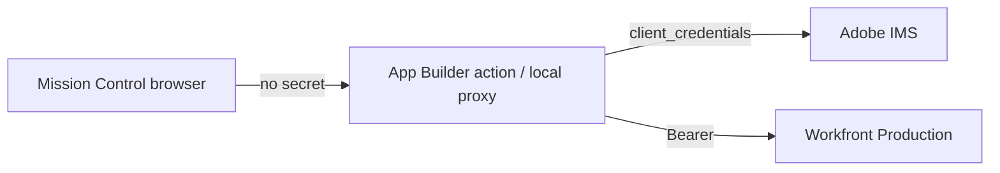

# Authenticating to Adobe Workfront

**Status: Step 4 proxy health is built. Live submit (dual-write) is still off.**

The Request Queue assembles a complete, valid Workfront payload and still refuses to POST it. What
changed in Step 4 is the connection path: Mission Control can ask **our** proxy whether Workfront is
reachable, without ever holding `client_secret`.

Adopting Adobe Developer Console + App Builder Runtime is a **Vendor Management Policy consideration
under guardrail 8**. No live third-party write without explicit approval (Step 6).

## The short version

Use **Adobe Developer Console OAuth Server-to-Server**, behind the App Builder Runtime proxy in
`workfront-proxy/`. Do not build any flow from Workfront's own OAuth2 Applications screen, including
PKCE, however well PKCE appears to fit.

## Why the obvious options are closed

### Legacy Workfront custom OAuth2 applications

Created in Workfront under **Setup > System > OAuth2 Applications**, limit ten per instance. Covers
three flows: authorization code, PKCE, and JWT server auth.

| Date | What happens |
| --- | --- |
| **2026-11-01** | No new legacy OAuth2 applications can be created |
| **2027-02-01** | Existing legacy OAuth2 applications stop working |

No extension is planned. Building on this now means building something with a known, dated end.

### PKCE deserves its own paragraph, because it looks like the answer

PKCE is the one flow designed for an application with no backend: the client generates a verifier,
sends `code_challenge_method=S256`, and exchanges the code without a client secret. That is exactly
this app's shape — a static bundle on a static host with no server of its own.

**It is still inside the retiring family, so it is a dead end.** This is written down specifically to
stop the next person from rediscovering PKCE, recognizing how well it fits, and spending a sprint on
it. The fit is real. The deadline is also real.

### API keys and the `/login` endpoint

Workfront states it no longer recommends either. Beyond the recommendation, the practical problem is
scope: an API key is per-user and inherits that user's access, so an administrator's key confers
administrator access to whatever holds it. A key in a browser bundle would be an administrator
credential published on the internet.

## What Step 4 ships

- `workfront-proxy/` — Runtime action `workfront-health` plus a local stand-in (`npm run workfront:proxy`).
- Secrets: `WORKFRONT_CLIENT_ID`, `WORKFRONT_CLIENT_SECRET`, `WORKFRONT_HOST`, optional
  `WORKFRONT_PROJECT_ID`. Never `VITE_*`. Local file: `.env.workfront.local` (gitignored).
- Client calls same-origin `/api/workfront/health` in dev (Vite proxies to `127.0.0.1:8787`), or the
  public `WORKFRONT_PROXY_URL` baked at build time.
- Success body: `{ connected: true, project: { ID, name } }` — no token, no secret.
- Request Queue header and Manage Queue notice read that health result.

## Attribution: whose name is on the request?

Server-to-Server authenticates as one service identity. Every issue it creates would show that
integration account as **Entered By**, not the person who filled in the brief. For an intake queue
whose entire purpose is knowing who asked for what, that is a real loss, not a cosmetic one.

Two ways out, and they are genuinely different products:

1. **A Workfront UI Extension.** It receives the signed-in user's IMS token and `user = {ID, email}`
   through shared context, so the real requester is preserved. This means the tool lives inside
   Workfront rather than standing alone.
2. **Accept the service identity.** The requester then has to be carried in `A3IntakeRequestedBy` plus
   the description audit line that `buildWorkfrontPayload` already writes. If we take this path, **the
   queue UI has to say so** — a producer looking at Entered By would otherwise conclude the integration
   account raised the request itself.

That choice is not the developer's to make quietly. It changes what a Workfront record means.

## What the app still refuses to do

- `submitToWorkfront` remains local. It validates, assembles the real payload, and reports
  `mode: "local"`. Dual-write is Step 6.
- `sendBlockers` still ends with a live-submit blocker even when proxy health is green.
- Every row still reads **"Sent to Workfront: No"**, and `scripts/lib/copy-guard.mjs` fails the build
  on any phrasing that claims otherwise.

## Also unresolved

Attachments. Workfront takes documents through a separate upload call, and this app never persists
file contents — only names, in `AttachmentRef`. A request submitted through a proxy would arrive
without its files. That is a gap to close deliberately, not something to discover in production.
